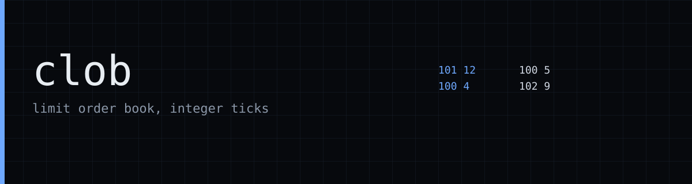

# clob

Limit order book. Price-time priority, integer ticks, no floats.

The trade price is the resting order's price. A market order does not rest. Whatever a limit order does not fill is added at the back of that price. Cancel removes one resting id. Unknown ids return false.

## Build

C++17.

```
make test
```

## Rules

- Buy and sell prices are positive `int64` ticks. Quantity is a positive `int64`.
- A buy limit matches asks at or below its price, lowest ask first. A sell limit matches bids at or above its price, highest bid first.
- The same price is a queue. The earlier order is filled first.
- Two orders cannot rest with the same id. After a full fill or a cancel the id can be used again.
- `levels` lists each side best price first.

```cpp
clob::Book book;
book.limit(1, clob::Side::Sell, 100, 5);
auto trades = book.limit(2, clob::Side::Buy, 100, 2);
// trades[0] == {taker 2, maker 1, price 100, qty 2}
```

## What is not here

No network, no accounts, no self-trade prevention, no stop, no iceberg, no modify. One thread: a `Book` is not safe to share without an external lock. Copying is disabled because the queue is an intrusive index of list iterators. Move leaves the source empty.
